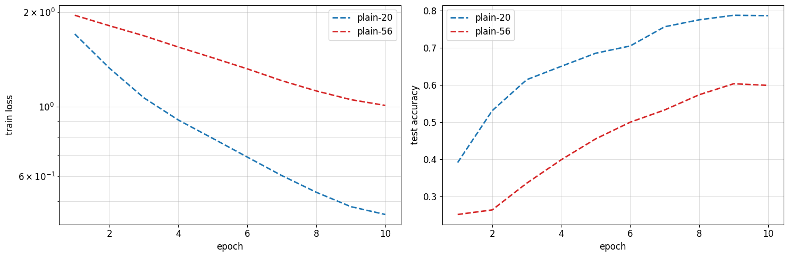
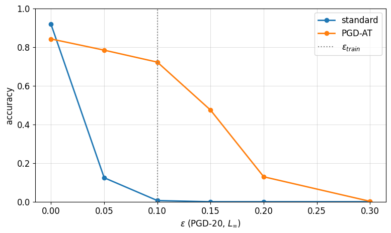
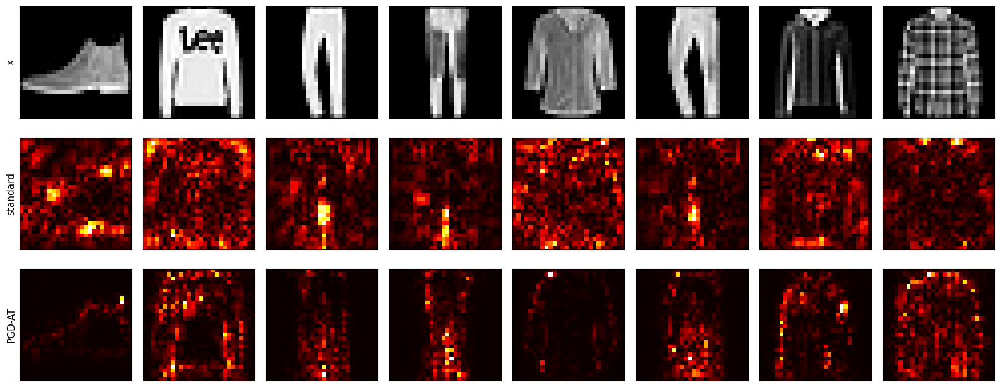
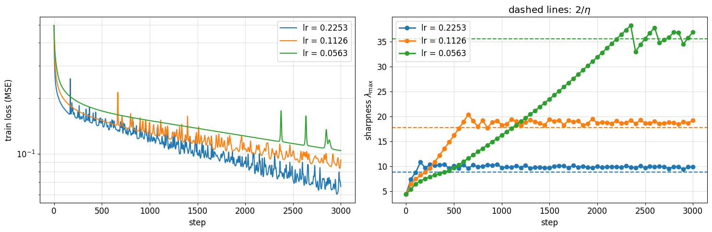
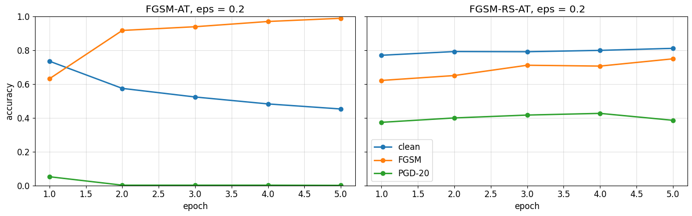

# ДЗ-1. Свёртки, обучение глубоких сетей, adversarial robustness

Решение в [`hw1.ipynb`](hw1.ipynb). Финальный прогон: `FAST_MODE = False`, Google Colab, Tesla T4, PyTorch 2.11. Ветка раздела 5: **targeted**. Бонусы: **7.1–7.5**.

## Что сделано

| Раздел | Задачи |
|---|---|
| 1. Свёртка изнутри | `conv2d` через `unfold` с groups/stride/dilation, ручной backward свёртки (`gradcheck`), receptive field и effective RF через autograd |
| 2. Нормализация | `BatchNorm2d` с нуля, совместимый по `state_dict`, слияние Conv + BN для инференса |
| 3. Инициализация и оптимизатор | дисперсия активаций по глубине для 4 инициализаций, свой `AdamW` с группами параметров, cosine schedule |
| 4. ResNet на CIFAR-10 | ResNet для CIFAR (residual / plain / separable), training loop, абляция plain-20 vs plain-56 |
| 5. Атаки | PGD-L2, targeted PGD и матрица успеха по парам классов |
| 6. Adversarial training | PGD-AT (Madry et al.), sanity checks оценки robustness, input gradients |
| 7. Бонусы | edge of stability (HVP + Lanczos), FFT-свёртка, Muon для свёрточных весов, L0-атака, catastrophic overfitting |

## Основные результаты

**CIFAR-10**

| Модель | Эпох | Train acc | Test acc |
|---|---|---|---|
| ResNet-20, `MyAdamW` + cosine | 20 | 1.000 | 0.829 |
| ResNet-20, Muon (conv) + AdamW | 20 | — | **0.853** |
| plain-20 | 10 | 0.855 | 0.786 |
| plain-56 | 10 | 0.635 | 0.598 |

plain-56 хуже plain-20 даже на train: это проблема оптимизации, а не переобучение (degradation problem из He et al.).

**FashionMNIST, L∞, eps = 0.1**

| Модель | Clean | FGSM | PGD-20 | PGD-100 × 5 рестартов |
|---|---|---|---|---|
| обычная | 0.918 | 0.086 | 0.012 | 0.008 |
| PGD-AT | 0.842 | 0.742 | 0.734 | 0.734 |

Input gradients у робастной модели сосредоточены на объекте: доля массы градиента на фоне 0.224 против 0.594 у обычной модели.

**Edge of stability.** При full-batch GD sharpness растёт и выходит на границу 2/η для всех трёх learning rate.

**Catastrophic overfitting.** FGSM-AT с eps = 0.2: FGSM accuracy 0.990, а PGD-20 падает до 0.001. С random start (FGSM-RS) PGD-20 держится около 0.39.

## Файлы

- `hw1.ipynb` — ноутбук с кодом, outputs и ответами на вопросы
- `artifacts/metrics.json` — все метрики финального прогона
- `artifacts/*.pt` — `state_dict` моделей: ResNet-20, обычная и PGD-AT CNN для FashionMNIST
- `assets/` — графики из ноутбука
