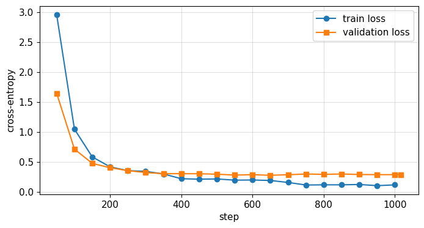
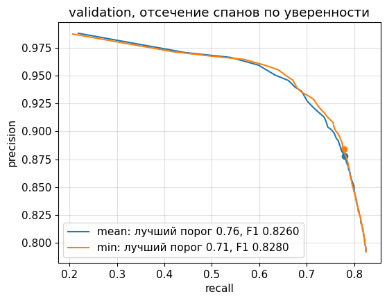

# ДЗ-2. NER: детекция сущностей в тексте

Решение в [`hw2_nlp.ipynb`](hw2_nlp.ipynb), трек NLP. Финальный прогон: `FAST_MODE = False`, Kaggle, Tesla T4, весь ноутбук примерно за 14 минут. Бонусы: **6.2-6.5**.

- Модель: [`ai-forever/ruBert-base`](https://huggingface.co/ai-forever/ruBert-base), revision `05f37a2c`, Apache-2.0
- Датасет: [NEREL](https://github.com/nerel-ds/NEREL), русские новости, 29 типов сущностей, ручная разметка. Загрузка из [`iluvvatar/NEREL`](https://huggingface.co/datasets/iluvvatar/NEREL), лицензия в источниках не указана

## Что сделано

| Раздел | Задачи |
|---|---|
| 1. Модель | фиксация ревизии, `do_lower_case=False` (в репозитории модели нет `tokenizer_config.json`), параметры по блокам, формы тензоров |
| 2. Данные | своя конвертация NEREL: документы со спанами по символам -> предложения и слова -> внешние спаны -> BIO. Тесты конвертации, статистика по типам и сплитам, проверка через jsonl |
| 3. Бейзлайн | словарный теггер по самому частому тегу слова, энкодер со случайной головой |
| 4. Дообучение | `Trainer`, 3 эпохи, кривые loss, отчет seqeval, свой `token_f1` |
| 5. Анализ | категории ошибок (boundary / type / missed / spurious), абляция с замороженным энкодером |
| 6. Бонусы | rubert-tiny2 против base, порча текста, int8 и fp16, порог уверенности спана |

## Основные результаты

| Модель | Сплит | F1 micro | F1 macro | token F1 |
|---|---|---|---|---|
| словарный бейзлайн | val | 0.285 | 0.242 | |
| случайная голова | val | 0.003 | 0.003 | |
| ruBert-base | val | 0.808 | 0.659 | 0.861 |
| ruBert-base | test | **0.819** | **0.710** | 0.869 |
| ruBert-base, замороженный энкодер, LR 1e-3 | val | 0.646 | 0.484 | 0.751 |
| rubert-tiny2 | test | 0.699 | 0.489 | |

Лучше всего находятся PERSON (F1 0.975 на test), AGE, CITY, COUNTRY и DATE. Хуже всего EVENT (0.60) и редкие DISTRICT и FAMILY (0). При переходе к плоскому BIO теряется 21% сущностей, т к в NEREL много вложенных спанов.

Eval loss выходит на минимум 0.276 к концу второй эпохи, дальше почти не меняется. Обучение заняло 124 с.

**Ошибки на validation:** boundary 29%, spurious 26%, type 24%, missed 21%. Больше половины пропусков приходится на EVENT.

**Устойчивость (6.3):** чистый validation дает F1 0.808. В нижнем регистре 0.685, с опечатками 0.728, в верхнем регистре 0.290, в транслите 0.205.

**Скорость (6.4):** fp16 на T4 ускоряет в 4.3 раза без потери F1. Int8-квантизация энкодера на CPU дает только 1.12x и роняет F1 до 0.681.

**Порог уверенности (6.5):** порог по минимальной уверенности слова, подобранный на validation, поднимает F1 на test с 0.819 до 0.829.

## Файлы

- `hw2_nlp.ipynb`: ноутбук с кодом, outputs финального прогона и ответами
- `artifacts/metrics.json`: метрики основной части
- `artifacts/bonus.json`: результаты бонусов 6.2-6.5
- `assets/`: графики из ноутбука

Данные и веса не коммитятся. Ноутбук сам скачивает модель и датасет, зависимости ставит первая ячейка.
